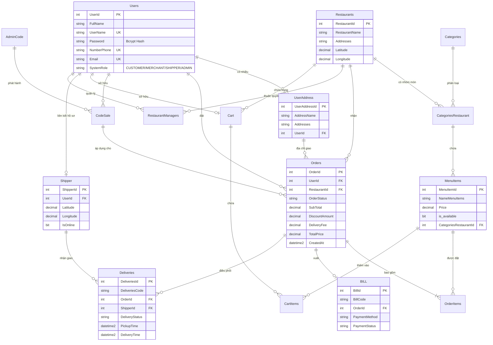

# 🍔 Food Ordering & Delivery Management System

Hệ thống đặt món và điều phối giao đồ ăn toàn diện (Full-stack Ecosystem) được xây dựng theo kiến trúc hiện đại, hỗ trợ **4 phân quyền độc lập** (Khách hàng, Nhà hàng, Tài xế, Quản trị viên), tích hợp **Bản đồ định vị thông minh (GIS/Leaflet)**, **Trợ lý ảo AI (Google Gemini)** và **Hệ thống bảo mật đa tầng**.

---

## 📑 Mục Lục
- [1. Tính Năng Nổi Bật](#1-tính-năng-nổi-bật)
- [2. Kiến Trúc & Công Nghệ Sử Dụng](#2-kiến-trúc--công-nghệ-sử-dụng)
- [3. Sơ Đồ Chức Năng 4 Phân Quyền](#3-sơ-đồ-chức-năng-4-phân-quyền)
- [4. Sơ Đồ Quan Hệ Cơ Sở Dữ Liệu (ERD)](#4-sơ-đồ-quan-hệ-cơ-sở-dữ-liệu-erd)
- [5. Hướng Dẫn Cài Đặt & Khởi Chạy](#5-hướng-dẫn-cài-đặt--khởi-chạy)
- [6. Cấu Trúc Thư Mục](#6-cấu-trúc-thư-mục)

---

## 🌟 1. Tính Năng Nổi Bật

### 🗺️ Bản Đồ Số & Định Vị Tọa Độ (Map & Geocoding)
* **Leaflet & OpenStreetMap**: Tích hợp bản đồ tương tác trực quan cho cả **Khách hàng** và **Tài xế (Shipper)**.
* **Định tuyến thông minh (Smart Routing)**: Tự động vẽ lộ trình di chuyển tối ưu cho Shipper:
  $$\text{Vị trí Shipper} \longrightarrow \text{Nhà hàng (Lấy món)} \longrightarrow \text{Địa chỉ Khách (Giao hàng)}$$
* **Thuật toán Fallback Geocoding (Photon API)**: Tự động phân tích và bóc tách địa chỉ văn bản của người dùng để tìm tọa độ (Kinh độ/Vĩ độ) chính xác ngay cả khi địa chỉ nhập vào bị thiếu hoặc viết tắt.
* **Theo dõi đơn hàng theo thời gian thực (Live Order Tracking)**: Khách hàng có thể theo dõi tiến độ di chuyển và vị trí của Shipper ngay trên giao diện trực quan.

### 🤖 Trợ Lý Trí Tuệ Nhân Tạo (Google Gemini AI)
* **AI Chatbot cho Khách hàng (Customer Support)**: Tư vấn chọn món ăn theo sở thích, gợi ý thực đơn phù hợp, giải đáp thông tin món ăn và trạng thái đơn hàng.
* **AI Chatbot cho Nhà hàng (Business Assistant)**: Tích hợp ngay trong **Dashboard** và **Manager Menu**:
  * Phân tích dữ liệu doanh thu và xu hướng món ăn bán chạy.
  * Đưa ra lời khuyên tối ưu hóa thực đơn và điều chỉnh chiến lược kinh doanh.

### 🛡️ Bảo Mật Đa Tầng (Enterprise Security)
* **Bcrypt Password Hashing (10 Salt Rounds)**: Mã hóa mật khẩu an toàn chuẩn công nghiệp với cơ chế tự động nâng cấp (Auto-migration) cho tài khoản cũ khi đăng nhập.
* **Xác thực JWT (JSON Web Token)**: Phân quyền truy cập tài nguyên (Role-Based Access Control - RBAC) nghiêm ngặt cho từng vai trò người dùng.
* **Rate Limiting**: Tích hợp `express-rate-limit` trên toàn bộ API backend nhằm ngăn chặn các cuộc tấn công DDoS, Brute-force và Spam request.
* **SQL Injection Prevention**: Sử dụng Parameterized Queries với Connection Pooling trong Microsoft SQL Server (`mssql`).

---

## 💻 2. Kiến Trúc & Công Nghệ Sử Dụng

| Tầng | Công nghệ / Thư viện | Vai trò |
| :--- | :--- | :--- |
| **Frontend** | **Next.js 16 (App Router)** | Framework React 19 tối ưu SSR/CSR và SEO |
| | **Redux Toolkit (RTK)** | Quản lý State tập trung toàn ứng dụng |
| | **Tailwind CSS v4** | Hệ thống Styling hiện đại, responsive cao cấp |
| | **Leaflet & React-Leaflet** | Hiển thị bản đồ, marker, route chỉ đường |
| | **Lucide React** | Bộ icon giao diện trực quan |
| **Backend** | **Node.js & Express 5** | RESTful API Server hiệu năng cao |
| | **TypeScript** | Định kiểu tĩnh an toàn, hạn chế lỗi runtime |
| | **Controller - Service - Repository** | Kiến trúc Clean Architecture tách biệt logic rõ ràng |
| | **Google Generative AI SDK** | Kết nối Gemini AI Model (`gemini-3.5-flash-lite`) |
| | **Bcrypt & JWT** | Băm mật khẩu và cấp phát token phiên đăng nhập |
| | **Express Rate Limit** | Giới hạn tần suất gọi API bảo vệ hệ thống |
| **Database** | **Microsoft SQL Server (MS SQL)** | Cơ sở dữ liệu quan hệ, lưu trữ dữ liệu có cấu trúc |
| | **Spatial Geography Data** | Hỗ trợ kiểu dữ liệu địa lý lưu kinh độ/vĩ độ |

---

## 👥 3. Sơ Đồ Chức Năng 4 Phân Quyền

```mermaid
graph TD
    System((Hệ Thống Food Ordering))

    %% Phân quyền CUSTOMER
    System --> Customer[👤 Khách Hàng - Customer]
    Customer --> C1[Khám phá món ăn & Nhà hàng]
    Customer --> C2[Giỏ hàng & Áp dụng Mã giảm giá]
    Customer --> C3[Đặt hàng & Thanh toán COD/Banking]
    Customer --> C4[Theo dõi Shipper trên Bản đồ Leaflet]
    Customer --> C5[Quản lý thông tin & Sổ địa chỉ nhận]
    Customer --> C6[Trò chuyện cùng AI Chatbot tư vấn món]

    %% Phân quyền SHIPPER
    System --> Shipper[🛵 Tài Xế - Shipper]
    Shipper --> S1[Bật/Tắt trạng thái Online nhận đơn]
    Shipper --> S2[Xem danh sách đơn hàng chờ giao]
    Shipper --> S3[Nhận đơn & Cập nhật trạng thái giao hàng]
    Shipper --> S4[Bản đồ chỉ đường: Shipper - Quán - Khách]
    Shipper --> S5[Lịch sử các chuyến giao & Thu nhập]

    %% Phân quyền MERCHANT
    System --> Merchant[🏪 Nhà Hàng - Merchant]
    Merchant --> M1[Dashboard thống kê doanh thu & đơn]
    Merchant --> M2[Quản lý thực đơn: Thêm/Sửa/Xóa món ăn]
    Merchant --> M3[Xác nhận đơn, chuyển trạng thái chế biến]
    Merchant --> M4[AI Chatbot hỗ trợ phân tích menu & bán hàng]

    %% Phân quyền ADMIN
    System --> Admin[👑 Quản Trị Viên - Admin]
    Admin --> A1[Dashboard tổng quan toàn hệ thống]
    Admin --> A2[Báo cáo & Phân tích chuyên sâu Analytics]
    Admin --> A3[Quản lý Người dùng & Đối tác Nhà hàng/Shipper]
    Admin --> A4[Quản lý Đơn hàng toàn hệ thống]
    Admin --> A5[Tạo & Phân phối Mã giảm giá CodeSale]
```



### Chi tiết các phân quyền:

1. **Khách hàng (Customer / User)**:
   - Tìm kiếm quán ăn theo danh mục (Categories: Đồ ăn, Đồ uống, Món chay, Pizza, Lẩu, Sushi, v.v.).
   - Quản lý giỏ hàng (`Cart`, `CartItems`), lưu giữ nhiều món theo từng nhà hàng.
   - Áp dụng mã giảm giá (`AdminCode` / `CodeSale`) trừ theo % hoặc số tiền cố định.
   - Xem hóa đơn điện tử (`BILL`), chọn phương thức thanh toán (`CASH` hoặc `BANKING`).
   - Sổ địa chỉ (`UserAddress`): Thêm, sửa, xóa nhiều địa chỉ nhận hàng linh hoạt.
   - **Tương tác AI Chatbot**: Nhận đề xuất món ăn thông minh theo khẩu vị.

2. **Tài xế (Shipper)**:
   - Dashboard theo dõi các đơn hàng ở trạng thái `READY_FOR_PICKUP` hoặc `FINDING_DRIVER`.
   - Nhận đơn và chuyển đổi mốc tiến độ giao nhận:
     $$\text{ACCEPTED} \rightarrow \text{ARRIVED\_AT\_STORE} \rightarrow \text{PICKED\_UP} \rightarrow \text{ARRIVED\_AT\_BUYER} \rightarrow \text{DELIVERED}$$
   - Xem tọa độ GPS và lộ trình đường đi trực tiếp trên bản đồ Leaflet.

3. **Nhà hàng (Merchant)**:
   - Quản lý thực đơn (`MenuItems`): Bật/tắt trạng thái còn món, đổi giá, hình ảnh, thứ tự hiển thị.
   - Quản lý nhóm món theo nhà hàng (`CategoriesRestaurant`).
   - Xử lý đơn hàng: Tiếp nhận (`CONFIRMED`), bắt đầu nấu (`PREPARING`), báo món xong (`READY_FOR_PICKUP`).
   - **AI Business Assistant**: Nhận hỗ trợ từ Gemini AI về thống kê và gợi ý món bán chạy.

4. **Quản trị viên (Admin)**:
   - Thống kê toàn diện về doanh thu, số lượng đơn đặt, tỷ lệ hoàn tất đơn.
   - Quản lý danh sách tài khoản, khóa hoặc phân quyền hệ thống (`SystemRole`).
   - Quản lý danh mục món ăn dùng chung toàn hệ thống.
   - Tạo mã khuyến mãi: Thiết lập ngày bắt đầu, ngày hết hạn, giới hạn số lượt dùng và số tiền giảm tối đa.

---

## 🗄️ 4. Sơ Đồ Quan Hệ Cơ Sở Dữ Liệu (ERD)



---

## 🚀 5. Hướng Dẫn Cài Đặt & Khởi Chạy

### Yêu cầu môi trường
* **Node.js**: >= 18.x
* **Microsoft SQL Server**: 2017 trở lên
* **Git**

---

### Bước 1: Clone dự án & Thiết lập Database
1. Clone mã nguồn về máy:
   ```bash
   git clone https://github.com/bang-nguyen-2807/Food-Ordering-System.git
   cd Food-Ordering-System
   ```
2. Mở **SQL Server Management Studio (SSMS)**:
   * Chạy script [foodOrderingSystemDB.sql](file:///d:/TuHocNextjs-Nangcao/Nextjs-express-product/FoodOrderingSystem/foodOrderingSystemDB.sql) để tạo bảng và quan hệ.
   * Chạy script [dataInsertValue.sql](file:///d:/TuHocNextjs-Nangcao/Nextjs-express-product/FoodOrderingSystem/dataInsertValue.sql) để nạp dữ liệu mẫu ban đầu.

---

### Bước 2: Cài đặt và cấu hình Backend
1. Truy cập thư mục `back-end`:
   ```bash
   cd back-end
   npm install
   ```
2. Cấu hình file `.env` tại thư mục `back-end/`:
   ```env
   DB_USER=sa
   DB_PASSWORD=your_sql_password
   DB_SERVER=localhost
   DB_PORT=1433
   DB_NAME=FoodOrderingSystem
   JWT_SECRET=your_super_secret_jwt_key
   JWT_EXPIRES_IN=1d
   GEMINI_API_KEY=your_google_gemini_api_key
   GEMINI_MODAL=gemini-3.5-flash-lite
   ```
3. Chạy Backend ở chế độ Development:
   ```bash
   npm run dev
   ```
   *Server sẽ lắng nghe tại: `http://localhost:5000` (hoặc cổng cấu hình)*

---

### Bước 3: Cài đặt và cấu hình Frontend
1. Mở cửa sổ terminal mới và truy cập vào `front-end/my-app`:
   ```bash
   cd front-end/my-app
   npm install
   ```
2. Cấu hình file `.env.local`:
   ```env
   NEXT_PUBLIC_API_KEY=your_optional_public_key
   ```
3. Chạy giao diện Next.js:
   ```bash
   npm run dev
   ```
4. Mở trình duyệt và truy cập: **`http://localhost:3000`**

---

## 📂 6. Cấu Trúc Thư Mục

```
Food-Ordering-System/
├── back-end/                     # REST API Backend (Express + TypeScript)
│   ├── src/
│   │   ├── config/              # Kết nối Database MS SQL
│   │   ├── controller/          # Điều hướng nhận request và response
│   │   ├── services/            # Xử lý Business Logic nghiệp vụ
│   │   ├── repositories/        # Thao tác truy vấn Database SQL
│   │   ├── routes/              # Định nghĩa các endpoint API
│   │   ├── middleware/          # Rate limiter, Auth guard JWT
│   │   ├── utils/               # JWT token, Password Hash, Helper
│   │   └── server.ts            # Entrypoint Backend
│   ├── package.json
│   └── tsconfig.json
│
├── front-end/my-app/             # Next.js 16 Application
│   ├── app/                     # App Router đa phân quyền
│   │   ├── admin/               # Module Quản trị viên
│   │   ├── restaurant/          # Module Quán ăn/Nhà hàng
│   │   ├── shipper/             # Module Tài xế & Bản đồ giao hàng
│   │   ├── users/               # Module Khách hàng & Đặt món
│   │   └── authentication/      # Đăng nhập & Đăng ký
│   ├── components/              # Reusable UI Components, Chatbot, Leaflet Map
│   ├── store/                   # Redux Toolkit Slices & Store
│   └── package.json
│
├── foodOrderingSystemDB.sql     # Script khởi tạo cấu trúc CSDL
├── dataInsertValue.sql          # Script nạp dữ liệu mẫu ban đầu
├── queryDB.sql                  # Các câu lệnh truy vấn mẫu
└── README.md                    # Tài liệu hướng dẫn dự án
```

---

## 👨‍💻 Tác giả
* Dự án được xây dựng và phát triển bởi **Bang Nguyen** ([@bang-nguyen-2807](https://github.com/bang-nguyen-2807)).